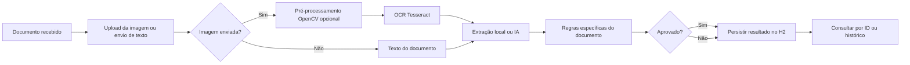

# Validação de documentos com Java

API didática em Spring Boot para demonstrar um pipeline de validação. O serviço recebe texto ou imagem, pode pré-processar a imagem com OpenCV e usar Tesseract para OCR, interpreta os campos com OpenAI quando configurada (ou com regras locais como fallback) e aplica as regras de negócio.

## Escopo do MVP

- **Problema:** reduzir o tempo e o retrabalho da conferência manual de documentos usados em cadastros e análises financeiras.
- **Usuário:** analistas de cadastro e equipes de backoffice de empresas.
- **Documentos:** comprovante de residência, documento de identificação (RG/CNH) e comprovante de renda.
- **Dados:** nome e CPF em todos; endereço e CEP para residência; número e validade (quando impressa) para identificação; renda mensal para comprovante de renda; data de emissão quando aplicável.
- **Fluxo:** upload de imagem ou envio de texto → OCR → extração local ou IA → regras específicas do tipo → resultado persistido → consulta por identificador ou histórico.
- **Armazenamento:** H2 local para demonstração. São guardados os dados extraídos e o resultado; a imagem original e o texto integral do documento não são armazenados.
- **Limite do MVP:** o sistema verifica presença/formato dos campos, CPF, datas e valor de renda. Não verifica autenticidade do documento, titularidade da conta/endereço nem capacidade de pagamento. Uma falha técnica de OCR é reportada como erro, não como reprovação de negócio.

### Fluxo da solução



### Regras de aprovação

- **Residência:** nome, CPF válido, endereço, CEP com oito dígitos e emissão há no máximo 90 dias, sem data futura.
- **Identificação:** nome, CPF válido e número do documento. Se houver data de validade no texto, ela não pode estar vencida; não se presume uma data de vencimento para documentos sem validade impressa.
- **Renda:** nome, CPF válido, renda mensal positiva e data de emissão há no máximo 90 dias, sem data futura.
- **Rejeição:** campo obrigatório ausente/inválido ou regra específica não atendida. O resultado lista as pendências.

## Como demonstrar

1. Inicie a aplicação com `mvn spring-boot:run` e abra `http://localhost:8080`.
2. Selecione **Comprovante de residência** e clique em **Exemplo**. O formulário recebe um texto de demonstração com os campos necessários.
3. Clique em **Validar documento**. Mostre o status aprovado, os dados extraídos, as regras atendidas e o protocolo.
4. Para demonstrar uma reprovação, remova a linha do CEP ou altere o CPF para um valor inválido e valide novamente. A interface deve mostrar a pendência.
5. Selecione a segunda validação no histórico para mostrar a consulta de um resultado persistido.
6. Para demonstrar outro tipo, selecione **Documento de identificação** e use um texto com `Nome`, `CPF` e `RG` ou `CNH`. Para renda, use também `Renda mensal: R$ 2.500,00` e uma `Data de emissao` recente.

O modo de texto não depende de serviços externos. Para demonstrar o caminho de imagem, configure o Tesseract e envie uma imagem legível com campos compatíveis com o tipo escolhido. A qualidade do OCR depende da imagem, do idioma e dos dados instalados no ambiente.

## Decisões técnicas e aprendizados

- **Uma aplicação para API e interface:** a página estática é servida pelo Spring Boot junto com a API. Isso deixa a demonstração simples de executar e evita manter um segundo servidor ou processo de build do front-end.
- **Regras determinísticas no servidor:** a IA e o OCR ajudam a interpretar o conteúdo, mas a decisão é calculada em Java. Assim, os critérios de aprovação podem ser testados e não dependem de a IA decidir se um documento está aprovado.
- **Extração flexível para documentos diferentes:** cada tipo possui campos e regras próprias. Um campo opcional, como validade impressa em alguns documentos, não deve ser inventado quando não aparece no texto.
- **Falha técnica não é reprovação:** um erro ao chamar OCR ou IA é diferente de um documento que não atende às regras. A API reporta falhas de processamento como erro para não confundir a decisão de negócio.
- **Minimização de dados:** o histórico armazena campos extraídos e resultado, não a imagem nem o texto integral. Mesmo assim, nome e CPF são dados pessoais; o banco local de demonstração deve ser protegido e não receber documentos reais sem definir controles de acesso, retenção e segurança apropriados.
- **Persistência adequada ao protótipo:** H2 em arquivo facilita executar e demonstrar o MVP. Não substitui a configuração, operação, controle de acesso e cópias de segurança de um banco de produção.
- **Testes automatizados tornam as regras verificáveis:** casos de aprovação, rejeição, datas, extração, endpoints, upload e consulta ajudam a detectar regressões sem depender de uma demonstração manual.

## Próximos passos para evoluir além do MVP

1. Validar as regras com analistas e exemplos autorizados de cada documento, incluindo variações de layout, campos ausentes e imagens de diferentes qualidades.
2. Melhorar a extração de CEP, valores monetários e números de RG/CNH com formatos reais; medir a precisão do OCR antes de usar os resultados em processos operacionais.
3. Avaliar suporte a PDF, com extração segura de texto e/ou conversão de páginas em imagens para OCR.
4. Adicionar autenticação, autorização, trilha de auditoria, política de retenção e proteção dos dados em repouso antes de aceitar documentos reais.
5. Planejar a migração de H2 para um banco gerenciado e incluir backups, monitoramento e tratamento de falhas operacionais.
6. Avaliar detecção de adulteração, validação de autenticidade e revisão humana. Esses recursos exigem fontes e critérios próprios; não são cobertos pelas regras atuais do MVP.

## Requisitos e execução

- Java 25+
- Maven 3.9+

```powershell
mvn spring-boot:run
```

Depois, abra `http://localhost:8080` para usar a interface web da demonstração. Ela permite escolher o tipo de documento, enviar imagem ou texto, visualizar a decisão e os dados extraídos e consultar o histórico salvo. O modo de imagem depende do Tesseract; o modo de texto funciona sem OCR.

## Endpoints

### `GET /api/documentos/exemplo`

Retorna um payload de exemplo com a data de emissão atual.

### `POST /api/documentos/validar`

Exemplo de request:

```json
{
  "nomeArquivo": "comprovante-residencia.pdf",
  "mimeType": "application/pdf",
  "conteudoDocumento": "COMPROVANTE DE RESIDENCIA\nNome: Joao da Silva\nCPF: 529.982.247-25\nEndereco: Rua das Flores, 150\nCEP: 46430-000\nCidade: Guanambi - BA\nData de emissao: 04/11/2026",
  "imagemBase64": null,
  "tipoDocumento": "COMPROVANTE_RESIDENCIA"
}
```

`tipoDocumento` aceita `COMPROVANTE_RESIDENCIA`, `DOCUMENTO_IDENTIFICACAO` ou `COMPROVANTE_RENDA`. Se omitido em requests antigos, o sistema usa `COMPROVANTE_RESIDENCIA`.

Envie `conteudoDocumento` para usar a extração local ou envie uma imagem em `imagemBase64` após configurar o Tesseract. `mimeType` deve corresponder ao formato da imagem.

### Upload de imagem

Com o Tesseract configurado, envie uma imagem multipart (limite de 10 MB):

```powershell
curl.exe -F "tipoDocumento=COMPROVANTE_RESIDENCIA" `
  -F "arquivo=@C:\documentos\comprovante.png;type=image/png" `
  http://localhost:8080/api/documentos/upload
```

O upload aceita PNG, JPEG, TIFF ou BMP. PDFs não são aceitos neste MVP. O endpoint retorna `201 Created` com o resultado e seu identificador.

### Consultar resultados

- `GET /api/documentos/{id}` consulta uma validação pelo identificador retornado.
- `GET /api/documentos/historico` lista as 100 validações mais recentes.

Os resultados ficam no banco H2 em arquivo na pasta `data/`, preservados entre reinicializações. Para testes automatizados, o projeto usa um banco H2 em memória.

O retorno inclui o identificador, o tipo, os campos extraídos, as etapas do pipeline, data da validação e resultado das regras:

- nome, CPF, endereço, cidade, CEP, número do documento, data de validade, renda mensal e data de emissão;
- aprovação de acordo com as regras do tipo selecionado;
- pendências para campos ausentes, CPF inválido, CEP inválido, renda inválida, datas futuras, vencidas ou com mais de 90 dias.

## Pré-processamento com OpenCV

Opcionalmente, configure `app.opencv.command` com um comando externo que receba o caminho do arquivo de entrada e o caminho de saída, nessa ordem. Por exemplo, no PowerShell:

```powershell
$env:APP_OPENCV_COMMAND="python scripts/preprocessar_documento.py"
```

O script deve ler o primeiro argumento, aplicar o pré-processamento usando OpenCV e salvar a imagem tratada no segundo argumento. Exemplo de configuração completa:

```python
import cv2
import sys

imagem = cv2.imread(sys.argv[1])
cinza = cv2.cvtColor(imagem, cv2.COLOR_BGR2GRAY)
tratada = cv2.threshold(cinza, 0, 255, cv2.THRESH_BINARY + cv2.THRESH_OTSU)[1]
if not cv2.imwrite(sys.argv[2], tratada):
    raise RuntimeError("Não foi possível salvar a imagem pré-processada")
```

O comando é iniciado sem shell. Se o caminho do executável ou de algum argumento contiver espaços, coloque esse trecho entre aspas no valor da propriedade. O processo tem limite de 60 segundos. Se o OpenCV não estiver configurado, a imagem original segue para o OCR.

## OCR com Tesseract

O projeto usa o idioma português (`por`) por padrão. No Windows, instale o Tesseract e o modelo de português:

```powershell
winget install --id UB-Mannheim.TesseractOCR --exact
$dataPath = Join-Path $env:LOCALAPPDATA "Tesseract\tessdata"
New-Item -ItemType Directory -Path $dataPath -Force
Invoke-WebRequest `
  -Uri "https://raw.githubusercontent.com/tesseract-ocr/tessdata_best/main/por.traineddata" `
  -OutFile (Join-Path $dataPath "por.traineddata")
```

Configure os caminhos para o usuário atual. O aplicativo lê `APP_OCR_COMMAND` como `app.ocr.command` e `APP_OCR_TESSDATA_PATH` como `app.ocr.tessdata-path`:

```powershell
$tesseractPath = "C:\Program Files\Tesseract-OCR\tesseract.exe"
$dataPath = Join-Path $env:LOCALAPPDATA "Tesseract\tessdata"
[Environment]::SetEnvironmentVariable("APP_OCR_COMMAND", $tesseractPath, "User")
[Environment]::SetEnvironmentVariable("APP_OCR_TESSDATA_PATH", $dataPath, "User")
```

Feche e reabra o VS Code para que ele e os terminais recebam as variáveis. Para iniciar a aplicação imediatamente no terminal atual, defina-as também nessa sessão:

```powershell
$env:APP_OCR_COMMAND = "C:\Program Files\Tesseract-OCR\tesseract.exe"
$env:APP_OCR_TESSDATA_PATH = Join-Path $env:LOCALAPPDATA "Tesseract\tessdata"
mvn spring-boot:run
```

Verifique se o Tesseract encontra o modelo:

```powershell
& $env:APP_OCR_COMMAND --tessdata-dir $env:APP_OCR_TESSDATA_PATH --list-langs
```

O OCR aceita imagens PNG, JPEG, TIFF e BMP. Quando configurado, o pré-processamento OpenCV ocorre antes do Tesseract. Ambos são executados localmente, sem passar argumentos por um shell.

Se o Tesseract não estiver configurado e o request contiver `conteudoDocumento`, esse texto continua sendo usado como fallback. Sem texto e sem OCR configurado, a API retorna `400 Bad Request`.

## Interpretação com OpenAI

Configure uma chave de API para interpretar o texto reconhecido:

```powershell
$env:OPENAI_API_KEY="sua-chave"
mvn spring-boot:run
```

Também é possível configurar `app.ai.openai.api-key`, `app.ai.openai.model` (padrão `gpt-4o-mini`) e `app.ai.openai.base-url` (padrão `https://api.openai.com/v1`) em `application.properties`. A aplicação envia o texto para `/chat/completions` e solicita uma resposta JSON com nome, CPF, endereço, cidade e data de emissão. O serviço não registra a chave nem o texto enviado.

Sem chave, a extração local baseada em padrões continua sendo usada. Quando a chave está configurada, erros da API ou respostas incompatíveis são reportados como erro e não são ocultados pelo fallback local. As regras de negócio continuam sendo aplicadas em Java nos dois modos.
